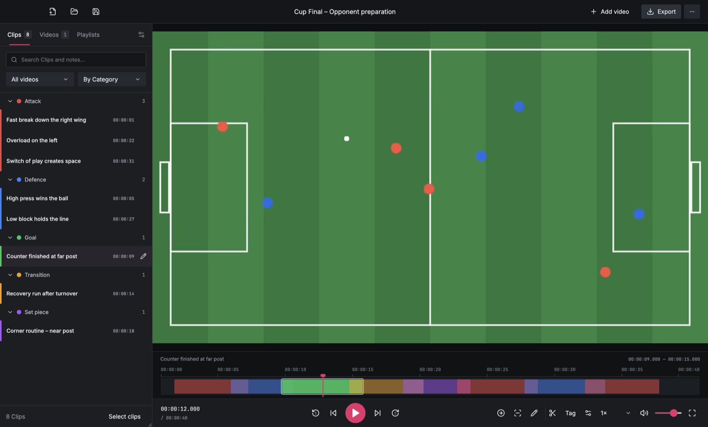
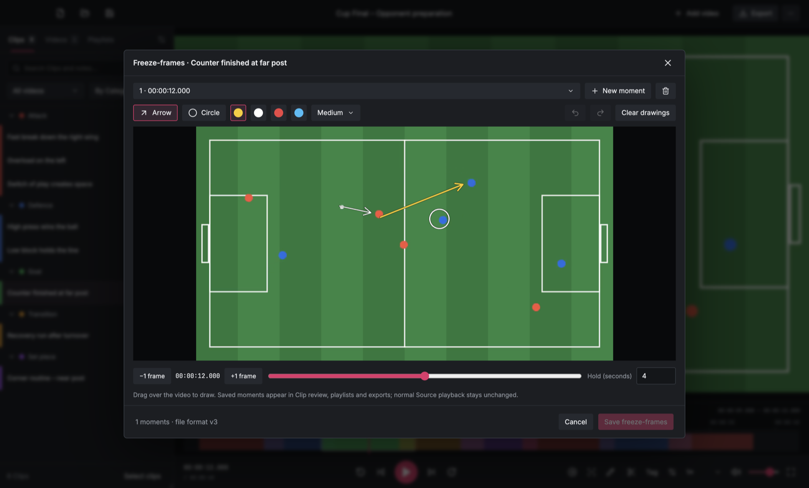
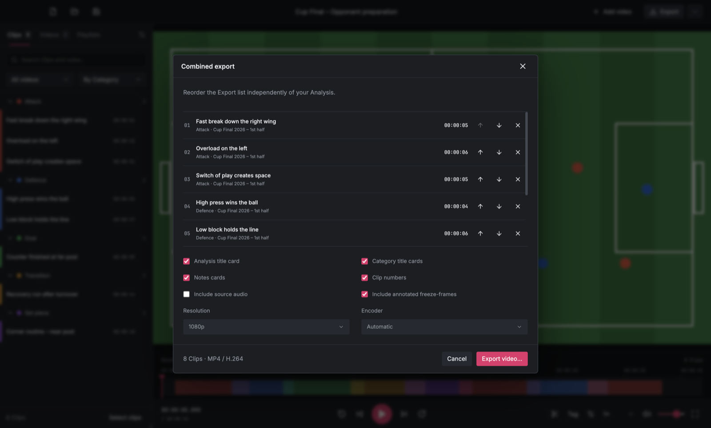

<div align="center">

# 🎬 Tacticut

**Cross-platform sports video analysis for coaches: tag, trim, sequence, and export match footage.**

[](https://github.com/maxwernz/Tacticut/actions/workflows/desktop.yml)


</div>

---

Tacticut (formerly *Video Analyse TS*) is a TypeScript desktop rewrite of the Python/PySide/QML [Video Analyse](https://github.com/maxwernz/Video-Analyse) app. Electron provides the desktop shell, React renders the workspace, and native FFmpeg processes do the video work. You don't need Python installed.

<p align="center">
  
</p>

## ✨ Highlights

- **German and English.** Open **Settings** (gear, or `⌘/Ctrl+,`) to change language, theme, capture timing and navigation. Menus, controls, the tour and human-readable reports follow the selected language; project names, categories and notes keep their original text. Preferences stay on this device.
- **Light and dark appearance.** Choose Light, Dark or System from the toolbar; the preference is remembered on this device.
- **Welcome tour.** A project welcome screen and 17 guided chapters explain the workspace. Start from the welcome screen or reopen it with **? → Welcome tour** / **Help → Welcome tour**.
- **Live tagging.** Press `1`–`9` during playback to capture a Clip in a Category without pausing.
- **Precise clips.** Mark in/out with `M`, then scrub, trim, and add notes on a single compact timeline.
- **Multiple sources.** Work across several match videos in one Analysis, and relink media if it moves.
- **Coaching playlists.** Build ordered sequences from any Clips, play them back across Source videos, and export them.
- **Handball analysis.** Record player/keeper and tactical tags, inspect shot sectors and goal targets, combine filters, and turn matching clips into review playlists or exports.
- **Freeze-frame coaching.** Pause on key moments, draw arrows and circles, and include those holds in playback and exports.
- **Fast native export.** FFmpeg renders 720p/1080p combined exports with title, Category, and notes cards. It shows progress and can be cancelled.
- **Safe by design.** Saves use atomic replacement, a crash-recovery snapshot protects unsaved edits, the renderer is sandboxed, and IPC goes through a narrow preload bridge.
- **Backward compatible.** Projects are saved as `.tcut` files. Tacticut still opens and saves older `.analysis` files (same JSON format as the Python app; rename a `.tcut` file to `.analysis` to open it there) and imports legacy pickle files safely.
- **Opens from Finder and Explorer.** Double-click a `.tcut` (or older `.analysis`) file to open it. Tacticut asks about unsaved changes first.
- **Clips from match statistics.** An optional MCP server lets Claude find BWHV match videos and turn game-time moments into Analyses or MP4 clips (see [`mcp/README.md`](mcp/README.md)).

## 📸 Screenshots

<table>
  <tr>
    <td width="33%"></td>
    <td width="33%"></td>
    <td width="33%"></td>
  </tr>
  <tr>
    <td align="center"><strong>Coaching playlists</strong></td>
    <td align="center"><strong>Freeze-frame annotations</strong></td>
    <td align="center"><strong>Combined export</strong></td>
  </tr>
</table>

<sub>The screenshots use a synthetic demo video.</sub>

## 📦 Install (macOS)

1. Download `Tacticut-<version>-arm64.dmg` from the [latest release](https://github.com/maxwernz/Tacticut/releases/latest) (Apple Silicon, macOS 14+).
2. Open it and drag **Tacticut** into **Applications**. Run it from there, not from the disk image, or it can't update itself.
3. The app isn't notarized by Apple, so macOS blocks the first launch. Open it once, then go to **System Settings → Privacy & Security** and click **Open Anyway**. Alternatively, run `xattr -dr com.apple.quarantine /Applications/Tacticut.app` once.

### Updates

Tacticut checks GitHub Releases on launch and every six hours. You can also use **Tacticut → Check for Updates…**. When a newer version is out, a card offers **Install and restart**. The app downloads the new build, checks its signature, asks you to save unsaved changes, then restarts into the new version. If you choose **Later**, a downloaded update installs the next time you quit.

Updates are signed with an Ed25519 key. The app only installs a build signed with the key whose public half it carries (`electron/updates/signature.ts`).

## 🚀 Getting started

Requires **Node.js 22.12+** (Node 24 recommended).

```sh
npm ci        # installs dependencies, including native FFmpeg/ffprobe binaries
npm run dev   # launches the app with hot reload
```

A saved **Analysis is a project**: one `.tcut` file stores your source-video references, clips, categories, handball tags, freeze-frame drawings, playlists and saved views. It can contain several recordings. Video files remain outside the project; move them together or relink them in Videos. Use New/Open/Save to manage separate projects. The Projects button lists recent files and builds cross-match collections.

The empty workspace offers **Add Source video**, **Open project** and **Start welcome tour**. The tour highlights the real controls, supports Back/Next and direct chapter selection, and can be skipped with Escape. It pauses playback, blocks editing shortcuts while open, and returns to your previous tab without changing Analysis data. It is available again from the **?** toolbar button or **Help → Welcome tour**.

Choose **Light**, **Dark** or **System** with the appearance icon in the toolbar or **View → Appearance**. This is a device preference; it does not change saved projects or video/export colors.

Production build:

```sh
npm run build
npm start
```

Installing needs internet access. After that, the app processes all media locally.

## ⌨️ Keyboard shortcuts

| Key                         | Action                                                 |
| --------------------------- | ------------------------------------------------------ |
| `Space`                     | Play / pause (also pauses/resumes playlist sequences)  |
| `←` / `→`                   | Scrub by the selected playback speed                                         |
| `Shift` + `←` / `→`         | Jump the configured interval × playback speed                                      |
| `↑` / `↓`                   | Increase / decrease playback speed                     |
| `T`                         | Open the large Tag play panel around the playhead    |
| `M`                         | Mark Clip start, then press again to mark the end      |
| `1`–`9`                     | Quick-capture outside Tag play; toggle categories inside  |
| `Esc`                       | Leave batch selection / stop playlist playback         |
| `Cmd/Ctrl` + `S`            | Save                                                   |

Playback speeds range from 0.25× to 8×. At 8×, Left/Right move eight frames per press; at 0.5×, they request half-frame increments. Repeated keys accumulate while decoding catches up. The explicit Previous/Next frame buttons always move one frame; the jump buttons keep their configured interval.

Shortcuts are ignored while a text field or dropdown has focus. New, Open, Save As, Add Source videos, and Combined export are also in the native menus.

## 🧭 Workflow

<details>
<summary><strong>Sources and playback</strong></summary>

- Add Source videos with the button or by dragging them onto the window. Use the **Videos** tab to switch, rename, reorder, remove, and relink them.
- Playback speed and volume controls sit below the video. The timeline scrubs, selects ranges, and jumps to a Clip's start when you double-click it.

</details>

<details>
<summary><strong>Creating and editing Clips</strong></summary>

- Click **Tag play** or press **T** to open the large unified panel around the current moment. Select several coaching categories, player/team/keeper, result, phase, court origin and goal target in one place. **Save Clip** (Command/Control + Enter) commits exactly one scene; Cancel leaves the project unchanged.
- Press **M** to mark a precise start and end. The same panel opens when the end is marked, or when editing a clip. **Clip timing & preview** adjusts boundaries; the small video previews the bounded clip.
- Quick capture (`1`–`9` or the **Quick capture** menu) uses 8 s of context before the playhead and 3 s after it by default. Choose **Short**, **Play**, or **Possession** presets, or change the timing with the settings button beside Quick capture. **Navigation settings** there also changes the jump buttons and Shift+arrow interval (1–120 seconds). Settings are remembered on this device. Quick capture doesn't pause playback or disturb a pending manual start. It ignores held-key repeats and clamps clips to the video's boundaries.
- Click a Clip to jump to it. Double-click it or use the pencil button to edit.
- Filter Clips by Source video, search names, notes, and Categories, and sort by Category, start time, or creation order.
- **Select clips** shows checkboxes for batch export, deletion, or adding to a playlist.
- Manage Categories with the sidebar settings button. The Analysis menu edits the reusable Category template.

</details>

<details>
<summary><strong>Handball analysis</strong></summary>

- **Tag play** combines coaching categories with direct handball choices. Team/player describe the attacking side; keeper describes the defending side. Roster buttons preserve identity; typed names and recent suggestions also work. Court and goal choices do not imply a shot result: choose an outcome explicitly.
- **Quick capture settings → Handball capture context** applies repeated context to new quick captures and manual marks. Context is cleared when opening or creating another Analysis. Record outcomes individually in the Clip editor.
- The **Handball** tab combines coaching themes, team/player/keeper, tactical, source, search and sector filters. Multiple selected themes must all occur on the same clip; each clip is counted once. Click a shot origin or goal cell to filter its clips. Goal cells use the shooter’s perspective.
- Statistics describe tagged clips: shots require a goal/saved/missed/blocked outcome; conversion is goals/all shots, and on-target save percentage is saves/(goals+saves). Duplicate clips of an event count separately.
- **Save view** remembers the combined filters, source and search inside the Analysis for future sessions. **Play matching** immediately reviews the current results. **Shot maps** expands the clickable origin/target views.
- **Reports & player reviews** exports the matching clips as a PDF shooting report or CSV data table, or creates one playlist per attacking team/player. The player preview shows the number and contents before creation; unassigned clips remain outside player playlists. PDF totals use the same definitions as the panel; goalkeeper rows identify the attacking team faced.
- **Clips → Select clips → Tag** applies explicitly filled handball fields across the selection while preserving other tags. The dialog also has an explicit remove-all-tags mode.
- **Create review playlist** saves the matching clips in source/time order for playback. **Export matching** exports that same set. Playlists are snapshots, so later filter changes do not change them.

</details>

<details>
<summary><strong>Playlists</strong></summary>

- Create named coaching sequences. **Add Clips** searches existing Clips, the arrows reorder them, and × removes only the playlist reference. A Clip can belong to several playlists but appears only once in each.
- **Play playlist** plays each Clip in order and switches Source videos as needed. Click a row to start from that Clip. Seeking, editing, or opening dialogs cancels the sequence. Switching sources may briefly buffer, so playback isn't gapless.
- **Export playlist** opens the export dialog with the Clips in playlist order.

</details>

<details>
<summary><strong>Export</strong></summary>

- Export the selected Clips, or all Clips if none are selected. You can reorder the export list and choose title, Category, and notes cards, Clip numbers, source audio, and 720p or 1080p output.
- Expand **Presentation** to add a silent half- or quarter-speed replay after every original Clip, or include team/player/keeper and tactical information on coaching cards. Saved drawing holds appear on the original only; the replay shows the raw footage.
- On macOS, Automatic mode tries VideoToolbox hardware encoding and falls back to software. Windows uses the `veryfast` software H.264 encoder.

</details>

<details>
<summary><strong>Freeze-frame coaching</strong></summary>

- Select a Clip, move the playhead to a frame, and click **Annotate selected Clip**. Finish or cancel any Clip draft or playlist playback first.
- Drag to draw **arrows**, **circles/ellipses**, **lines** and **text**, choose a color and thickness, and set a **0.5–15 s hold**. **New moment** adds another freeze to the same Clip. Undo/redo, Clear drawings, and Delete coaching moment only take effect when you click **Save freeze-frames**. Cancel asks before discarding changes.
- **Review Clip with freeze-frames** and playlist playback pause on each saved hold, then resume the footage. `Space` pauses or resumes a hold, and **Continue now** skips the rest of it. Stopping, seeking, changing Clips, or opening a dialog cancels the pending auto-resume. Fullscreen presentation shows the drawings.
- Combined export includes freeze-frames by default and is silent during each hold. Uncheck **Include annotated freeze-frames** to keep the original Clip timings. Drawings are stored in normalized picture coordinates and rasterized natively for export.
- Drawings follow their Clip into every playlist it appears in, and deleting a Clip deletes its moments. A trim that would exclude a moment is rejected. Use Select to move or resize existing shapes and text boxes. Automatic player tracking is not implemented.
- Frame stepping uses the nominal FPS. Check converted or variable-frame-rate footage visually.

</details>

## 🏗️ Architecture

```text
┌─────────────────────────── Electron ───────────────────────────┐
│  Renderer (sandboxed, no Node)        Main process              │
│  ┌──────────────────────────┐        ┌───────────────────────┐ │
│  │ React workspace          │  IPC   │ Native menus/dialogs  │ │
│  │  App · Player · Dialogs  │◄──────►│ Atomic file I/O       │ │
│  │  domain.ts (model/codec) │preload │ Media streaming proto │ │
│  └──────────────────────────┘        │ FFmpeg / ffprobe jobs │ │
│                                      └───────────────────────┘ │
└─────────────────────────────────────────────────────────────────┘
```

| Layer                                                  | Where                                     |
| ------------------------------------------------------ | ----------------------------------------- |
| Analysis model, codec, invariants, export ordering     | `src/domain.ts`                           |
| React editing and document lifecycle                   | `src/App.tsx`                             |
| Video element, transport, timeline                     | `src/Player.tsx`                          |
| Playlists and sequence playback                        | `src/Playlists.tsx`, `src/useSequencePlayback.ts` |
| Native menus and dialogs, restricted IPC, media streaming | `electron/main.ts`, `electron/preload.ts` |
| Atomic persistence, relative paths, media fingerprints | `electron/files.ts`                       |
| Probing and codec fallback copies                      | `electron/media.ts`                       |
| Freeze-frame model, editor, canvas, export rasterizing | `src/annotations.ts`, `src/AnnotationEditor.tsx`, `src/AnnotationCanvas.tsx`, `electron/annotations.ts` |
| Legacy pickle import                                   | `electron/legacy.ts`                      |
| Export preflight, rendering, cancellation              | `electron/export.ts`                      |

### Performance choices

- Frames never pass through JavaScript. FFmpeg does all decoding, encoding, and compositing natively.
- Exports run in async child processes. Each Clip is normalized into a temporary segment, and the final concatenation is stream-copied. This keeps memory bounded but uses temporary disk space.
- While a video plays, the playhead updates the DOM directly, so the Clip list doesn't rerender. Scrubbing is coalesced to animation frames.
- Checking a Source video's identity hashes three 64 KiB regions, not the whole file.
- Codecs the player can't handle are converted on demand into a cached 720p H.264/AAC playback copy. Exports still use the original media.

> Electron uses more RAM and disk space than Qt or Tauri. TypeScript is used here for the editing and document logic, and native code still does the expensive media work. The rewrite hasn't been benchmarked against the Python app.

## 📁 File compatibility

| Schema | Written when                  | Readable by                 |
| ------ | ----------------------------- | --------------------------- |
| v1     | Analysis has no playlists     | Python app and this app     |
| v2     | Analysis contains playlists   | This app only               |
| v3     | Clips have freeze-frames      | This app only               |
| v4     | Clips have handball tags      | Updated Tacticut only       |
| v5     | Analysis has saved views      | Updated Tacticut only       |
| v6     | Roster, grouped/custom-key categories, text/line drawings | Updated Tacticut only |
| v7     | Multiple category tags or category-filtered saved views | Updated Tacticut only |

- `.tcut` files (and older `.analysis` files) are JSON. The app keeps UUIDs, Clip creation order, Categories, notes, and external Source-video references intact. It uses the Python app's three-region SHA-256 media fingerprint.
- Relative Source-video paths let you move the media folder together with the Analysis. You can relink missing media without losing Clips.
- Older apps reject newer schema files instead of silently dropping playlists or drawings. To keep a copy they can open, use **Save As** first. Removing saved views, handball tags and freeze-frames allows later saves to return to v2 or v1.
- Saves check for external changes first. After an abnormal exit, the app offers a debounced recovery snapshot on the next launch.
- **Legacy pickle files** (`treewidget_item.ClipItem`) are imported with a restricted, data-only reader. It never imports Python globals or runs constructors. Files are limited to 32 MiB, and you must Save As to a new JSON file.

## Projects, team setup and editing

- **Projects** opens recent saved analyses. Browse existing `.tcut` or `.analysis` files and select 2–30 to create a separate cross-project collection. Collections copy saved clips, playlists, drawings and views; they do not follow changes to the original files. Review them with the same Handball filters, shooting reports and exports.
- **Analysis actions → Project setup** maintains teams, players, shirt numbers and goalkeeper roles. Choose identities from the roster in clip editing, batch tagging or capture context. Renaming linked people updates their labels; deleting them preserves the historical text. Reuse an exported setup template across matches to retain player identities. Independent same-name players remain separate.
- **Manage Categories** supports optional groups and individual 1–9 shortcut assignments. Reusable setup templates include groups, shortcuts and rosters, with validated JSON import/export. The simpler Category template still sets the defaults for new analyses.
- **Undo/Redo** on the toolbar, native Edit menu or Command/Control+Z / Shift+Z covers 100 committed project edits, including dependent playlist/drawing data when a clip is deleted. Save retains history; opening another project clears it. Text fields and the freeze-frame editor keep their own editing history.
- **Freeze-frames** supports arrows, circles, lines and text. Select a drawing to move it, resize its endpoints/box, change styling or delete it. Arrow keys nudge the selection; Shift moves farther. Drawings appear in clip review, playlists and video exports.
- **Handball → Reports & player reviews → Export player videos** renders one MP4 per attacking player from the current filtered selection. A new destination subfolder and JSON index preserve completed videos if a later job is cancelled. Optional half-speed replay and coaching notes use the normal export pipeline.
- The welcome tour includes projects, setup/templates and undo/redo.

## 🧪 Testing and packaging

```sh
npm test              # domain, persistence, React workflows, real FFmpeg exports
npm run test:e2e      # builds and drives the Electron app with Playwright (hidden, never takes focus)
TACTICUT_SHOW=1 npm run test:e2e   # same, with the app window visible for debugging
# Optional real-footage workflow, read-only original media:
TACTICUT_TEST_VIDEO="/path/to/match.mp4" npm run test:e2e
npm run package:mac   # run on ARM64 macOS  → release/*.dmg
npm run package:win   # run on x64 Windows  → release/*.exe (NSIS)
```

Build each package on its target OS so the bundled FFmpeg binaries match. macOS builds are signed ad hoc (Apple Silicon refuses unsigned code) and are not notarized. GitHub Actions tests and packages macOS and Windows independently on every push.

The app icon master is `public/app-icon.png`. After replacing it, run `npm run icons` on macOS to regenerate the committed macOS and Windows icons in `build-assets/`. The same master is used for development windows and the browser favicon.

### Releasing an update

```sh
# 1. bump "version" in package.json (installed copies only take a higher one)
# 2. commit and push
npm run release -- --notes "What changed"   # tests, builds, signs, publishes
npm run release -- --dry-run                # build and sign only
```

The script needs Node 23.6+, an Apple Silicon Mac, and `gh` logged in. It publishes `Tacticut-<version>-arm64.dmg` (for new installs), and the `.zip` and its `.sig` (for updates), to a GitHub release tagged `v<version>` on the pushed commit. It signs with `~/.config/tacticut/update-signing-key.pem` (or `TACTICUT_UPDATE_SIGNING_KEY`). **Back that key up.** If it's lost, installed copies can't verify new releases, and you'll have to reinstall manually from a build carrying a new key.

To try an update before publishing, point an installed copy at another feed with `TACTICUT_UPDATE_FEED=<url of a GitHub-style release JSON>`. Windows releases aren't published yet. The updater already handles NSIS installers named `Tacticut-<version>-x64-setup.exe` with a `.sig`.

Native dependencies ship with their own license files. The bundled fonts (Inter, JetBrains Mono, Noto Sans) are under the SIL Open Font License.

---

See [MIGRATION.md](MIGRATION.md) for parity decisions against the Python app and the remaining validation work.
